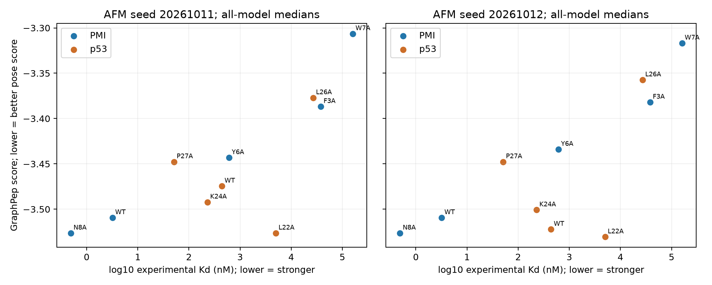

# MDM2：实测亲和力、结构来源与反馈选位诊断

**结论：当前评分目标与选位规则未通过预设验证，本轮不继续生成子代。** 两个 seed 均只有 5/7 项主要突变方向正确；在本面板内，PMI 家族排名一致，p53 家族排名接近无相关。绕过 PepMLM 后仍出现失败，因此这轮不能归因于 PepMLM 部署；实验坐标对照也出现与亲和力相反的方向，不能只归因于 AFM。证据支持先校准优化目标，而不是据此认定任一模型普遍无效。

本轮绕过 PepMLM，使用十条已知的 12-aa L 肽，不生成新子代。Kd 来自同一篇论文的同一 SPR 竞争实验与 synthetic MDM2(25–109) 构建体；没有把 MDMX、不同肽长度或其他 assay 的数值混入。
数据来源：[Li et al. 2010 Table 1/3 与方法](https://pmc.ncbi.nlm.nih.gov/articles/PMC2856455/)。肽为游离 N/C 端，Kd/SD 由 M 换算为 nM。

## 已知亲和力与 AFM→GraphPep

|肽|序列|实测 Kd±SD (nM)|seed 20261011 全模型中位分数|seed 20261012 全模型中位分数|通过模型数（两个 seed）|
|---|---|---:|---:|---:|---:|
|PMI_WT|`TSFAEYWNLLSP`|3.2 ± 1.1|-3.5094|-3.5094|6/6|
|PMI_N8A|`TSFAEYWALLSP`|0.49 ± 0.21|-3.5264|-3.5264|6/6|
|PMI_Y6A|`TSFAEAWNLLSP`|610 ± 70|-3.4432|-3.4340|6/6|
|PMI_F3A|`TSAAEYWNLLSP`|38000 ± 2000|-3.3868|-3.3820|6/6|
|PMI_W7A|`TSFAEYANLLSP`|160000 ± 30000|-3.3064|-3.3168|6/6|
|P53_WT|`ETFSDLWKLLPE`|440 ± 40|-3.4746|-3.5222|6/6|
|P53_P27A|`ETFSDLWKLLAE`|51 ± 3|-3.4477|-3.4477|6/6|
|P53_K24A|`ETFSDLWALLPE`|230 ± 20|-3.4922|-3.5008|6/6|
|P53_L22A|`ETFSDAWKLLPE`|5000 ± 400|-3.5264|-3.5306|6/6|
|P53_L26A|`ETFSDLWKLAPE`|27000 ± 1000|-3.3771|-3.3574|6/6|

GraphPep 越低与 Kd 越低方向一致，因此对 log10(Kd) 的相关系数应为正。两个 seed、六个 AFM 模型是计算敏感性检查，不是生物学重复。全模型结果与质量过滤结果分别报告，未通过结构门槛的弱结合肽不能被静默丢掉。

|seed|范围|聚合口径|可比较肽数|Spearman 与 log10(Kd)|
|---|---|---|---:|---:|
|20261011|all|median_score_all|10|0.736|
|20261011|all|median_score_passing|10|0.736|
|20261011|PMI|median_score_all|5|1.000|
|20261011|PMI|median_score_passing|5|1.000|
|20261011|p53|median_score_all|5|0.100|
|20261011|p53|median_score_passing|5|0.100|
|20261012|all|median_score_all|10|0.648|
|20261012|all|median_score_passing|10|0.648|
|20261012|PMI|median_score_all|5|1.000|
|20261012|PMI|median_score_passing|5|1.000|
|20261012|p53|median_score_all|5|0.000|
|20261012|p53|median_score_passing|5|0.000|

总体相关为 0.736/0.648，但 PMI 内为 1.000/1.000，p53 内仅 0.100/0.000。总体相关可能受核心锚点突变的大幅亲和力变化影响，不能替代同一骨架内的局部优化验证。十条肽的面板规模不足以支持跨受体或跨骨架的普遍结论。

## 单点突变方向

只将实测变化至少三倍的七项作为主要方向检查；K24A 的变化不到三倍，仅作描述。增益固定为逐模型配对的父代分数减突变分数之差的中位数，正数表示 GraphPep 改善。

|seed|突变|实测方向|Kd 比值(突变/父代)|配对中位增益|方向正确|可比模型|
|---|---|---|---:|---:|---|---:|
|20261011|PMI_N8A|stronger|0.153|+0.0170|是|3/3|
|20261011|PMI_Y6A|weaker|191|-0.0662|是|3/3|
|20261011|PMI_F3A|weaker|1.19e+04|-0.1372|是|3/3|
|20261011|PMI_W7A|weaker|5e+04|-0.2030|是|3/3|
|20261011|P53_P27A|stronger|0.116|-0.0269|否|3/3|
|20261011|P53_K24A|stronger|0.523|+0.0176|是|3/3|
|20261011|P53_L22A|weaker|11.4|+0.0386|否|3/3|
|20261011|P53_L26A|weaker|61.4|-0.0975|是|3/3|
|20261012|PMI_N8A|stronger|0.153|+0.0170|是|3/3|
|20261012|PMI_Y6A|weaker|191|-0.0754|是|3/3|
|20261012|PMI_F3A|weaker|1.19e+04|-0.1274|是|3/3|
|20261012|PMI_W7A|weaker|5e+04|-0.1926|是|3/3|
|20261012|P53_P27A|stronger|0.116|-0.0445|否|3/3|
|20261012|P53_K24A|stronger|0.523|+0.0000|否（持平）|3/3|
|20261012|P53_L22A|weaker|11.4|+0.0084|否|3/3|
|20261012|P53_L26A|weaker|61.4|-0.1448|是|3/3|

P27A 实测亲和力变强约 8.6 倍，GraphPep 却判变差；L22A 实测变弱约 11.4 倍，GraphPep 却判改善。这两项在两个 seed 的全部三个配对模型中均反向，并非只由中位数聚合造成。所有 60 个模型通过质量门槛，因此本轮质量过滤没有消除这些反例。K24A 在第二个 seed 的配对中位增益为零，不计作正确方向，也不纳入七项主要检查。

## 实验结构与预测结构

只比较化学序列匹配的 PMI(3EQS) 与 N8A-PMI(3LNZ)，保留 3LNZ 全部八个晶体副本。所有副本共同坐标为 MDM2 27–108 和肽 1–11；native 原始重原子坐标不移动，AFM 完整 85+12-aa 预测后按同一区域裁剪。原样解析范围评分另列，不能把裁剪序列当成其有 Kd 的截短肽。

|序列|结构来源/范围|seed|结构副本数|中位分数|最小—最大分数|
|---|---|---|---:|---:|---:|
|PMI_N8A|crystal_common|0|8|-3.4680|-3.5264 — -3.4340|
|PMI_WT|crystal_common|0|1|-3.5094|-3.5094 — -3.5094|
|PMI_N8A|crystal_resolved|0|8|-3.5030|-3.5635 — -3.4340|
|PMI_WT|crystal_resolved|0|1|-3.5094|-3.5094 — -3.5094|
|PMI_N8A|AFM_common|20261011|3|-3.4657|-3.4657 — -3.4657|
|PMI_N8A|AFM_common|20261012|3|-3.4657|-3.4657 — -3.4657|
|PMI_WT|AFM_common|20261011|3|-3.4657|-3.4657 — -3.4477|
|PMI_WT|AFM_common|20261012|3|-3.4657|-3.4657 — -3.4477|

[3EQS](https://www.rcsb.org/structure/3EQS) 和 [3LNZ](https://www.rcsb.org/structure/3LNZ) 的晶体副本不是独立亲和力测量，仅两个化学序列的对照不能证明普遍排名准确率。1YCR 的化学构建体与 p53(17–28) 不同，未给它的 native score 赋予 440 nM。原始坐标差异与 CA RMSD 见 `analysis/native_afm_rmsd.csv`。

共同范围内，N8A 八个晶体副本中六个评分比 WT 差，一个持平，一个更好；中位数方向与完整 12-mer 实测的约 6.5 倍亲和力改善相反。裁剪 AFM 的两条序列中位评分则在两个 seed 中均持平。受体 CA 对齐后，PMI WT 与 N8A 的肽 CA RMSD 中位数分别约 0.656 Å 和 0.647 Å，说明这对结构总体接近，但不能由此排除其他 p53 突变的局部结构误差。

这个对照仅涉及两个序列和缺失末端后的共同坐标，不能严格分解各模块对整套基准失败的因果贡献。完整 AFM 中 N8A 的改善在共同裁剪后消失，也不能在未做额外消融时归因于某一个删除残基。`predicted_common_results.csv` 的 `quality_metrics_source` 明确标记质量指标继承自完整 85+12-aa AFM 模型；裁剪后的 82+11-aa 结构未重新预测置信度。

## 低置信度选位规则

在保护 F3/W7/L10 的旧规则下，仅接触被观察到的非锚点参与选位；按父代通过质量门槛模型汇总接触置信度，取最低两位。以下列出本基准中实验变强的三项，K24A 仍为小幅变化。

|seed|突变|有接触反馈|接触数|平均置信度|旧规则会选中|Kd 比值|
|---|---|---|---:|---:|---|---:|
|20261011|PMI_N8A|False|0|nan|False|0.153|
|20261011|P53_P27A|True|9|0.924|False|0.116|
|20261011|P53_K24A|False|0|nan|False|0.523|
|20261012|PMI_N8A|False|0|nan|False|0.153|
|20261012|P53_P27A|True|9|0.963|False|0.116|
|20261012|P53_K24A|False|0|nan|False|0.523|

旧规则漏掉两项有明确实测收益的对照：N8 无接触反馈，直接被排除；P27（肽第 11 位）的接触置信度较高，也不会被优先选择。接触是否可信与突变是否有收益是不同问题；这两个漏选不能证明所有低置信度位置的突变都无收益。

## 冻结判据与下一步

本轮评分前的操作性门槛：每个 seed 的总体 rho≥0.6、两个家族 rho 均>0；七项主要方向至少六项正确，含两个变强对照，全部七项可比较。此门槛不代表统计显著性或普遍适用性。

- seed 20261011：主要方向正确 5/7，可比较 7/7；整体门槛 未通过。
- seed 20261012：主要方向正确 5/7，可比较 7/7；整体门槛 未通过。

当前 GraphPep 亲和力迭代目标未通过预定门槛，本轮停止沿该目标生成新子代。GraphPep 可保留为结构/接触评价工具；先建立独立亲和力目标及其正反基准，再继续生成闭环。该结果不能据此认定 PepMLM 有错，也不能仅凭高 AFM 置信度排除结构误差。

原论文指出 N8A 的收益涉及非接触位点的螺旋倾向。当前接触置信度不包含已验证的突变收益或游离肽构象熵分解；这需要单独的目标与实验检查。

后续独立目标方案如下，本轮未执行这些新计算：

1. 保留 GraphPep 作为结构与接触筛选信号，单独建立候选亲和力或相对结合自由能目标，继续用本面板作正反检查，不把 GraphPep 数值换算成 ΔG。
2. 优先要求新目标识别 N8A/P27A 的改善与 L22A 的损失，再检查锚点破坏对照；在查看新结果前确定判据，避免仅凭总体相关继续优化。
3. 选择方法时检查其是否考虑游离肽的构象与成螺旋代价。只对结合态做能量最小化或一次 MM/GBSA 评分不能自动解决这一问题；若评估 ΔΔG，应分别说明采样、收敛和不确定性。
4. 选位候选允许包含无接触的位置，缺失反馈单独标记。以后比较接触引导、螺旋/构象特征引导与匹配随机策略，使用同一可选位点集合和生成预算。
5. 独立目标通过基准后，才重启少量父代与子代的闭环；计算评分改善与实验 Kd 验证分别报告。此方案不要求训练大型模型。

## 核验与产物

AFM 模型 60 个，通过门槛 60 个；有效 GraphPep 分数 60 个；实验结构副本 9 个。冻结数据/脚本/GraphPep 源码/共同 MSA 哈希已核对。

原始逐模型数据 `analysis/model_results.csv`；双 seed 逐肽统计 `analysis/sequence_summary.csv`；方向检查 `analysis/mutation_directions.csv`；选位诊断 `analysis/feedback_vs_mutation.csv`；核验 `analysis/verification.json`。本轮不训练模型、不测量新子代 Kd，也没有计算 ΔG(binding)。

独立复算与冻结来源检查：[independent_verification.json](analysis/independent_verification.json)，全部通过；实际恢复运行检查：[cache_restore_verification.json](analysis/cache_restore_verification.json)，30 条缓存评分、接触计数、结构哈希与反馈路径保持一致。四项针对科学计算错误风险的测试通过。处理与解释边界详见 [execution_notes.md](execution_notes.md)，其中说明了缺失坐标、协议版本记录与尚未审计训练集重叠的限制。

